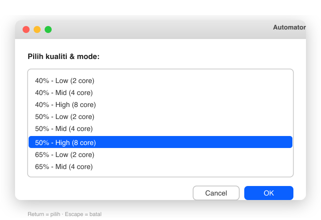

<div align="center">

# 🍎 image-to-webp (macOS)

**Convert images to WebP, right from Finder — with parallel multi-core speed.**

[](../LICENSE)
[](https://www.apple.com/macos/)
[](convert_to_webp.sh)
[](https://github.com/RafieRosliputra/image-to-webp/releases)

A **Finder Quick Action** that turns any image into **WebP** with selectable quality and multi-core parallel encoding.

</div>

---

## ✨ Features

| | |
|---|---|
| 🎚️ **Quality presets** | 40% · 50% · 65% lossy WebP via `cwebp` |
| ⚡ **Parallel encoding** | One file per core — Low (2) · Mid (4) · High (8) |
| 🧠 **Performance cores only** | Max 8 P-cores; efficiency cores stay idle |
| 🖥️ **Single dialog** | Quality + mode combined in one dropdown |
| ⌨️ **Keyboard-friendly** | `Return` = default · `Escape` = cancel |
| 🛡️ **Filename-safe** | Null-delimited `xargs` — spaces in names are fine |
| 🔔 **Completion banner** | Native macOS notification when done |

<p align="center">
  
</p>

## 🚀 Install

### One-liner (fastest)

Paste this single line into **Terminal** and press Enter:

```bash
curl -fsSL https://raw.githubusercontent.com/RafieRosliputra/image-to-webp/main/mac/install.sh | bash
```

It auto-installs `cwebp` (via Homebrew if missing), downloads the workflow, and registers it — nothing else needed.

> **Prefer to review first?**
> ```bash
> curl -fsSL https://raw.githubusercontent.com/RafieRosliputra/image-to-webp/main/mac/install.sh -o install.sh && cat install.sh
> bash install.sh
> ```

### Manual

**Option A — double-click.** Download the repo, double-click **`Convert to WebP.workflow`**, then click **Install** (or open in Automator and *File → Save As…* as a Quick Action).

**Option B — copy into Services.**
```bash
cp -R "Convert to WebP.workflow" ~/Library/Services/
/System/Library/CoreServices/pbs -flush
```

> `~/Library/Services/` is where macOS stores Quick Actions. Open it in Finder with `⌘⇧G` → `~/Library/Services/`.

### Verify

1. Right-click any `.jpg` / `.png` / `.tiff` / `.bmp` in Finder.
2. Hover **Quick Actions** → **Convert to WebP**.
3. Click it → press **Return** for default (50%, 8 cores).

## 🧰 Requirements

- **macOS 11+** (tested on Apple Silicon; Intel works too — adjust core counts)
- **`cwebp`** — installed automatically by the one-liner, or manually:
  ```bash
  brew install webp
  ```

## 📖 Usage

| Input | Output |
|-------|--------|
| `photo.jpg` | `photo.webp` |
| `image 01.png` | `image 01.webp` |

Supported input formats: `jpg`, `jpeg`, `png`, `tiff`, `bmp`. Others are ignored.

**Quality × mode matrix:**

| | Low (2 core) | Mid (4 core) | High (8 core) |
|---|---|---|---|
| **40%** | ✅ | ✅ | ✅ |
| **50%** | ✅ | ✅ | ✅ *(default)* |
| **65%** | ✅ | ✅ | ✅ |

## ⚙️ How it works

1. An **Automator "Run Shell Script"** Quick Action receives selected files.
2. A native AppleScript `choose from list` dialog offers 9 quality×mode combos.
3. The choice maps to `cwebp -q <quality>` + concurrency `NPROC`.
4. Files are piped (null-delimited) into `xargs -P $NPROC`, running `NPROC` parallel `cwebp` processes — one file per core.
5. A completion notification reports the result.

Full script: [`convert_to_webp.sh`](convert_to_webp.sh)

### Why not GPU?

WebP (`libwebp`) encoding is **CPU-only** — there is no Metal GPU encoder for WebP on Apple Silicon. (The only GPU WebP encoder, NVIDIA's `nvImageCodec`, is CUDA/NVIDIA-only.) Parallel CPU is the fastest available path.

## 📊 Benchmark

10 images (6000×4000) · Apple M1 Pro (8 P-cores + 2 E-cores):

| Mode | Time | Speedup |
|------|------|---------|
| Sequential (1 core) | 35.98 s | 1.0× |
| Parallel (8 cores) | **7.68 s** | **4.7×** |

## 🔧 Customizing

Edit the `.workflow` in Automator, or edit `convert_to_webp.sh`:

- **Quality presets** — edit the `choose from list` line + `case` mapping.
- **Core counts** — edit `NPROC=` values in the `case` block (keep ≤ your P-core count).
- **Default selection** — edit `default items {"50% - High (8 core)"}`.

## ❓ FAQ

**Does it overwrite my original files?**
No. It creates a new `.webp` next to the original; the source is untouched.

**What if a `.webp` with the same name already exists?**
It is overwritten.

**Why only up to 8 cores on my 10-core Mac?**
Your Mac has 8 *performance* cores + 2 *efficiency* cores. Capping at 8 keeps all work on performance cores for maximum speed.

**Can it use the GPU?**
No — WebP has no Metal GPU encoder. See [Why not GPU](#why-not-gpu).

## 📄 License

[MIT](../LICENSE) © [Rafie Rosliputra](https://github.com/RafieRosliputra)
